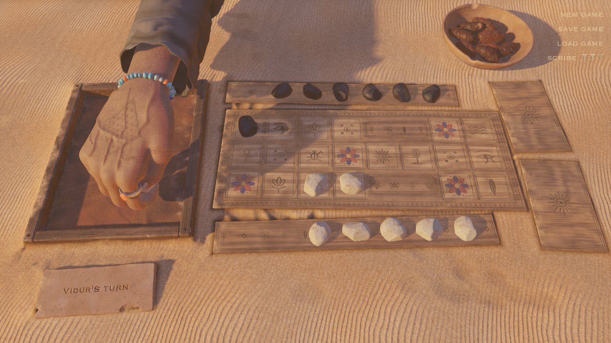
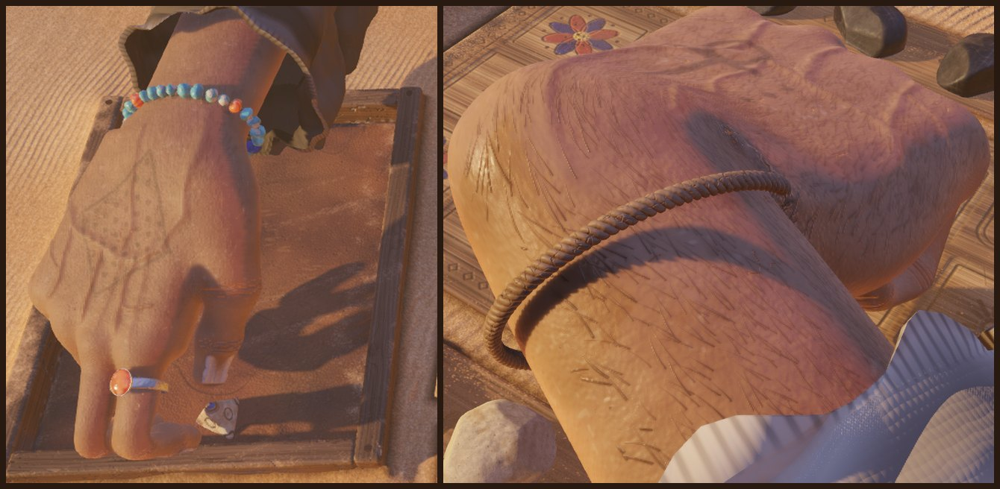
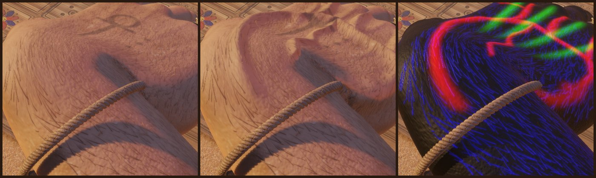
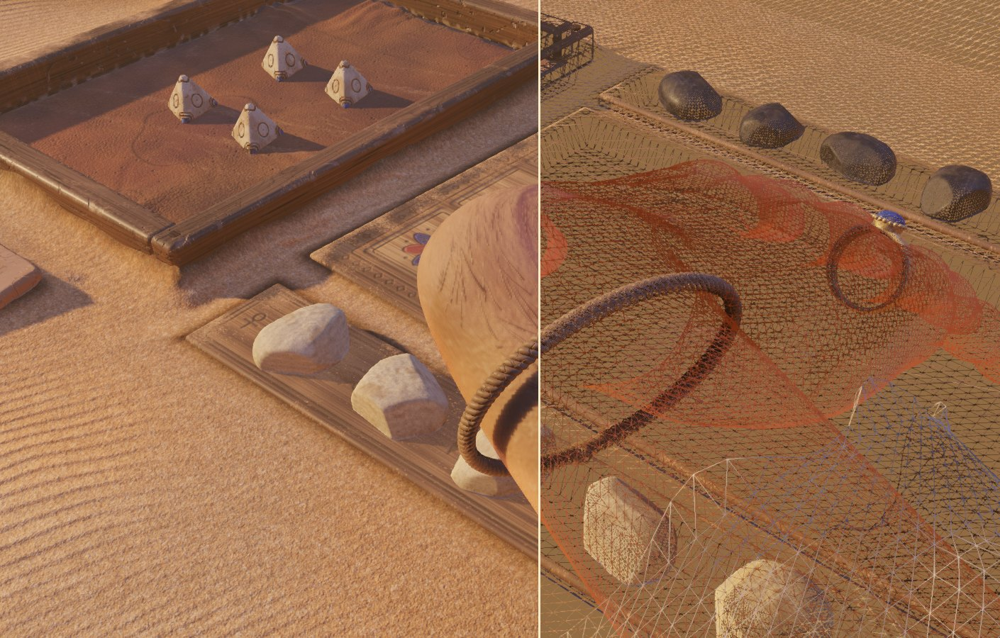
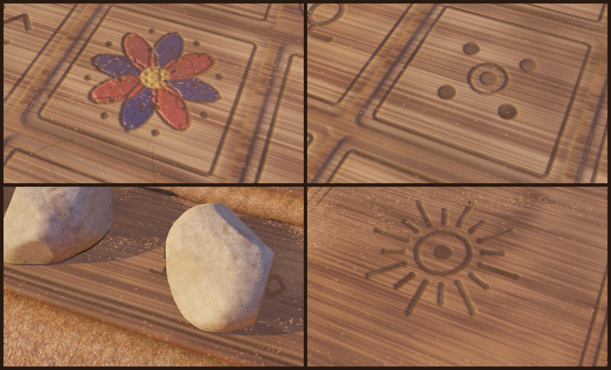
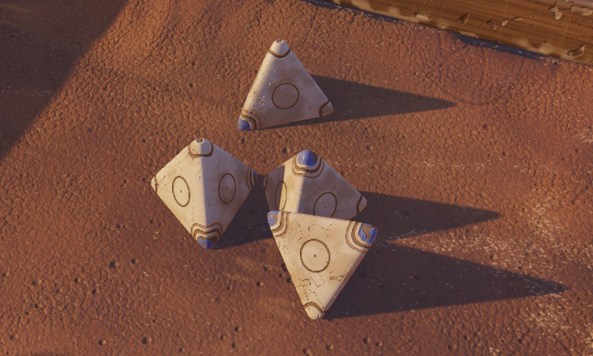
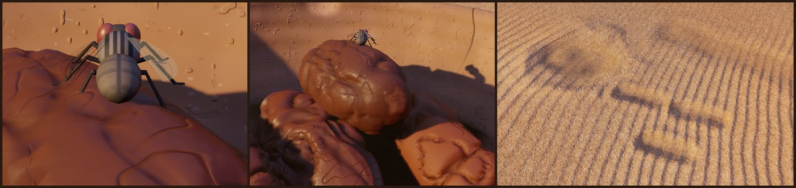
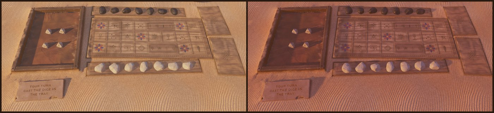

# The Royal Game of Ur

> **Disclaimer:** Designed by a human. Coded and documented by Claude.

A 3D version of the Royal Game of Ur, made in Godot 4.7.
You play against Vidur at a wooden board on the desert sand.



## The game

The Royal Game of Ur is a race game from Mesopotamia, approximately 4,500 years old.
This version uses the Finkel rules:

- Each player has 7 stones.
- Throw 4 tetrahedral dice. The result is 0 to 4.
- Move one stone that number of squares along your path.
- If you land on an opponent's stone in the middle row, you capture it. That stone goes back to the start.
- A rosette gives you one more throw.
- The middle rosette is safe. An opponent cannot capture a stone there.
- To bear a stone off, you must throw the exact number.
- The first player to bear off all 7 stones wins.

To learn the game, watch this video tutorial. Irving Finkel, who found the rules, teaches Tom Scott:
[Tom Scott vs Irving Finkel: The Royal Game of Ur](https://www.youtube.com/watch?v=WZskjLq040I&t=710s)

## How to play

1. Click the dice tray to throw the dice.
2. Read the result on the clay tablet.
3. Drag a stone to its new square. Or click the stone, then click the square.
4. If you cannot move, the turn goes to Vidur.

Use the links in the top-right corner:

- **new game** starts a new game.
- **save game** keeps the position from the start of the current turn. There is one save slot.
- **load game** goes back to the saved position.
- The **wedges** set Vidur's strength:
  - **novice** often makes careless moves.
  - **scribe** looks one throw ahead.
  - **master** looks three throws ahead.

## Details on the table

Most of the work in this game is not in the rules. It is in the table and the people at it.

### Hands

Two hands play: yours and Vidur's. Each hand reaches, grips and throws with its own fingers.
The skin has hair, veins and tendons.
The veins fill when the hand works hard. Sweat builds up slowly on the back of the hand.



The veins are live. They swell when the hand grips hard for a long time, and they drain when the hand lifts.
The shader draws the hair, veins and tendons from masks. It uses no painted texture for them.



A script makes the hand from an anatomical description: [tools/make_hand.py](tools/make_hand.py).
It is one continuous mesh with 22,294 vertices and 17 bones. The sleeve, the bracelet and the stones are separate meshes.



### Board and stones

A script makes every texture: [tools/make_textures.py](tools/make_textures.py). The game uses no photos.

- The glyphs are carved into the wood. They have depth and catch the light.
- The rosettes are painted. The paint is chipped and the wood shows through.
- The wood has grain and its edges are worn round.
- Each stone has its own shape. The white stones are marble. The black stones are basalt.
- Wind blows sand onto the wood. The sand collects on the edges that face the wind ([tools/make_dust.py](tools/make_dust.py)).



### Dice

The dice are physical objects. They roll, hit the walls of the tray and come to rest.
The hand picks them up one at a time, shakes them in its fist and throws them.
If a die does not stop after 2 seconds, the game reads it where it lies.



### A table that changes

- Vidur eats dates from a bowl while he waits. There are 12 dates. When he eats them all, there are no more.
- Flies come to the dates. Vidur moves them away with his hand.
- Hands, sleeves and date stones leave marks in the sand. The wind fills them in slowly.
- Stones that slide across the board wipe the dust off the wood.
- Clouds go across the sun. The sun goes down slowly over a long game.





### Sound

The sounds come from the table: wind, stone on wood, dice on leather, cloth sleeves, and Vidur when he chews.
The [tools/make_sounds.py](tools/make_sounds.py) script makes many of them.

## Run the game

1. Install [Godot 4.7.2](https://godotengine.org/).
2. Open this folder as a Godot project.
3. Push **F5** to start the game.

## Build the macOS app

1. Install the Godot 4.7.2 export templates (**Editor > Manage Export Templates**).
2. Run this command:

   ```sh
   ./build_macos.sh
   ```

The app goes in `build/macos/Royal Game of Ur.app`. Set `GODOT` if Godot is not in `/Applications`.

## Files

| File | Contents |
| --- | --- |
| [ur_game.gd](src/ur_game.gd) | The rules |
| [ur_ai.gd](src/ur_ai.gd) | Vidur's moves |
| [main.gd](src/main.gd) | The table, turns, input and camera |
| [hand.gd](src/hand.gd), [dice_grip.gd](src/dice_grip.gd) | The hands and how they hold the dice |
| [date_bowl.gd](src/date_bowl.gd), [flies.gd](src/flies.gd) | The dates and the flies |
| [traces.gd](src/traces.gd) | Marks in the sand and dust on the wood |
| [ambience.gd](src/ambience.gd) | Wind, cloth and chewing sounds |
| [tools/](tools/) | Python scripts that make the textures, sounds, dust and hand mesh |
| [tests/](tests/) | Godot scripts that check and take pictures of one part of the game |

To run a test, use this command:

```sh
godot --always-on-top --path . -s tests/capture.gd
```

On macOS, use `--always-on-top`. If you do not, the window can stop updating and screenshots repeat.

## Credits

Designed by Parth Parikh. Coded by Claude.
